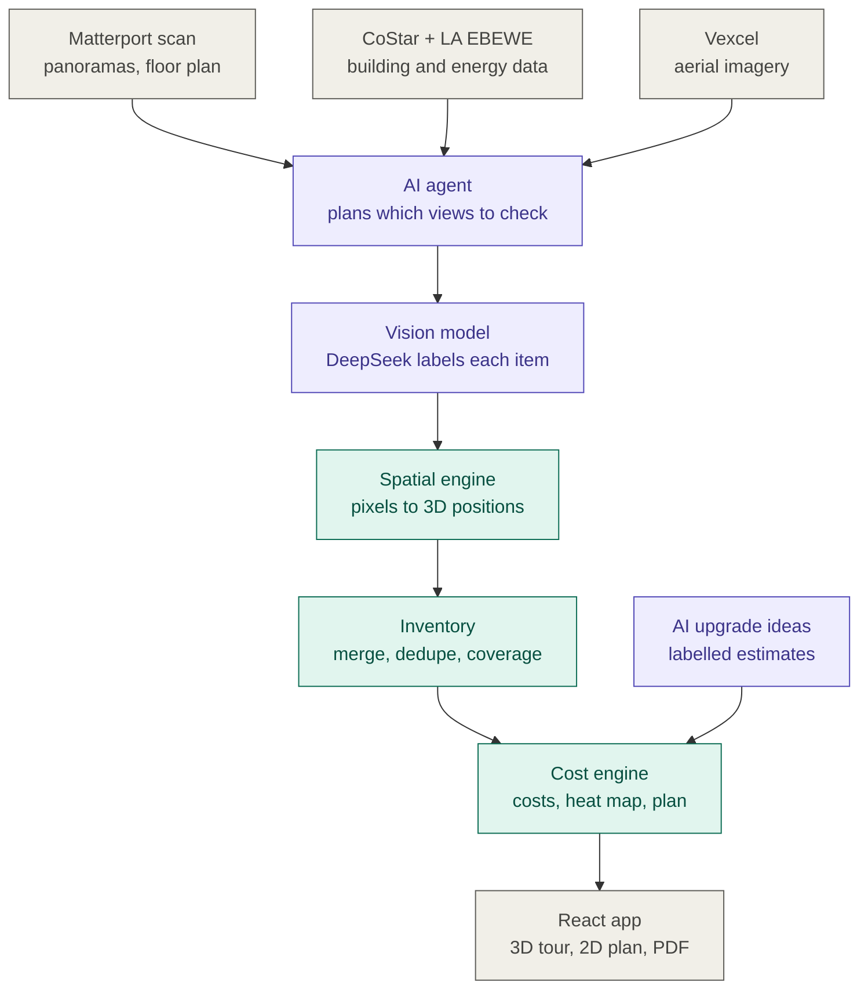

# WattWalk

An AI agent that walks a Matterport 3D apartment scan, builds an evidence-backed inventory of
energy-relevant assets (windows, lights, AC units, appliances…), places them as pins on a 2D floor
plan and in the 3D tour, and produces a costed upgrade plan that shows what the landlord pays and what
the tenant saves. Built at HackPrinceton Fall 2026 (CoStar "Inside and Out: AI for the Built World").

## How it works



Purple steps use an AI model, green steps are deterministic code, grey boxes are data in and the app out.
The AI only finds items and suggests ideas: every dollar figure comes from the cost engine and the sourced
values in `shared/contracts/assumptions.json`, and AI ideas are clamped and labelled as estimates.

| Step | Where in the code |
|---|---|
| AI agent (Deep Agents planner, or the scripted fallback) | `backend/wattwalk/agent/` |
| Vision model (labels checked against a fixed vocabulary) | `backend/wattwalk/vision/` |
| Spatial engine (raycasts, calibration, doorway triangulation) | `backend/wattwalk/spatial/`, `backend/wattwalk/vision/triangulate.py` |
| Cost engine (baseline, savings, optimizer, heat shares) | `backend/wattwalk/engine/` |
| AI upgrade ideas and product links | `backend/wattwalk/engine/ai_alternatives.py`, `backend/wattwalk/engine/products.py` |
| React app (Matterport SDK, 2D plan, plan sheet) | `frontend/src/` |

## Fastest way (two commands)

You need Python 3.11+, Node.js 20+ and Git. Then, from the repository root:

```bash
python3 scripts/setup.py     # once: installs everything, creates .env (asks for your keys), downloads the local AI
python3 scripts/run.py       # every time: starts the local AI, backend and frontend, opens the browser
```

On Windows use `py scripts\setup.py` and `py scripts\run.py`. `setup.py` is safe to run again: it skips
what is done and never overwrites an existing `.env`. Three things cannot be automated and come from
outside the repository: the Matterport keys (`/costar-keys` in the CoStar Discord), the CoStar kit
(licensed download), and allowing `localhost:5173` for the SDK key on my.matterport.com (section 3.6).

The rest of this guide is the same setup done by hand, plus how to use the app, prepare a demo and fix problems.

This guide takes you from a fresh computer to a working app. Follow the sections in order.

- [1. What you need](#1-what-you-need)
- [2. Five-minute check: fixture mode (no keys)](#2-five-minute-check-fixture-mode-no-keys)
- [3. Full live setup](#3-full-live-setup)
- [4. Run the app](#4-run-the-app)
- [5. Run an audit](#5-run-an-audit)
- [6. Before a demo: replay, reset, caches](#6-before-a-demo-replay-reset-caches)
- [7. Tests](#7-tests)
- [8. Troubleshooting](#8-troubleshooting)
- [9. Data, keys and what is never committed](#9-data-keys-and-what-is-never-committed)
- [10. Project layout](#10-project-layout)

---

## 1. What you need

| Tool | Version | Check with |
|---|---|---|
| Git | any recent | `git --version` |
| Python | **3.11 or 3.12** (3.13+ may lack wheels for some packages) | `python3 --version` |
| Node.js | **20 or newer** (npm comes with it) | `node --version` |
| Ollama (only for the free local AI, section 3.5) | latest | `ollama --version` |

Hardware for the local AI: about **8 GB free disk** and **16 GB RAM**. With less RAM, use Bedrock
(section 3.5, option B).

---

## 2. Five-minute check: fixture mode (no keys)

Fixture mode plays an illustrative apartment ("100 Example St") from files in the repository. No keys,
no internet, no AI. Use it to confirm your install works before adding keys.

**macOS / Linux**

```bash
git clone https://github.com/Dedeepya777/WattWalk.git
cd WattWalk
python3.12 -m venv .venv                 # or python3.11
source .venv/bin/activate
pip install -r backend/requirements.txt
python scripts/check_contracts.py        # should print: Contract check OK
uvicorn wattwalk.api.app:app --app-dir backend --port 8000
```

**Windows (PowerShell)**

```powershell
git clone https://github.com/Dedeepya777/WattWalk.git
cd WattWalk
py -3.12 -m venv .venv
.venv\Scripts\Activate.ps1
pip install -r backend/requirements.txt
python scripts/check_contracts.py
uvicorn wattwalk.api.app:app --app-dir backend --port 8000
```

Leave that terminal running. In a **second terminal**:

```bash
cd WattWalk/frontend
npm install
npm run dev
```

Open **http://localhost:5173**. Without a `.env` the frontend runs on built-in fixtures; you should see
"100 Example St", and pressing **Start audit** plays the sample audit. If that works, your install is good.

---

## 3. Full live setup

Live mode audits real Matterport scans with a real AI model. Everything is configured in **one file:
`.env` in the repository root** (the backend and the frontend both read it).

### 3.1 Create `.env`

```bash
cp .env.example .env            # Windows: copy .env.example .env
```

`.env` is in `.gitignore`. Never commit it, never paste it into chat or a pull request.

### 3.2 Every setting in `.env`

| Variable | What to put | Needed for |
|---|---|---|
| `WATTWALK_DATA_MODE` | `live` | real Matterport, CoStar, EBEWE data |
| `WATTWALK_VISION_MODE` | `live` | real AI detection |
| `WATTWALK_AGENT_MODE` | `scripted` (works without a planner model) or `deep_agents` (needs Bedrock, section 3.5) | the agent |
| `WATTWALK_AUDITS_DIR` | leave empty (defaults to `audits/`) | |
| `MATTERPORT_API_KEY` | from `/costar-keys` (section 3.3) | live data |
| `MATTERPORT_API_TOKEN` | from `/costar-keys` | live data |
| `MATTERPORT_SDK_KEY` | your Showcase SDK key (section 3.6) | 3D pins |
| `VITE_MATTERPORT_SDK_KEY` | **the same value as `MATTERPORT_SDK_KEY`** | 3D pins (the browser can only read `VITE_` names) |
| `VEXCEL_API_KEY` | from `/costar-keys`, optional | roof imagery (shows "unavailable" without it) |
| `COSTAR_KIT_ZIP` | full path to the CoStar kit zip **or** its unzipped folder (section 3.4) | year built, units, rent |
| `COSTAR_ZIP_PASSWORD` | the kit password, if you point at the zip | |
| `AWS_REGION` | `us-east-1` unless your Bedrock access is elsewhere | Bedrock |
| `DEEPSEEK_API_KEY` | DeepSeek API key (`sk-...`) | cloud AI detection and Deep Agents planning |
| `WATTWALK_SMALL_VISION_MODEL_ID` | `deepseek/deepseek-flash` or Bedrock/Gemini id (section 3.5) | AI detection |
| `WATTWALK_LARGE_VISION_MODEL_ID` | same idea; the "escalation" model | AI escalation |
| `WATTWALK_PLANNER_MODEL_ID` | `deepseek/deepseek-flash` for `deep_agents` mode | Deep Agents planner |
| `VITE_API_BASE` | `http://localhost:8000` | frontend talks to the backend (without it the frontend only plays fixtures) |

A working local `.env` therefore looks like this (values replaced):

```bash
WATTWALK_DATA_MODE=live
WATTWALK_VISION_MODE=live
WATTWALK_AGENT_MODE=deep_agents
DEEPSEEK_API_KEY=sk-...
WATTWALK_SMALL_VISION_MODEL_ID=deepseek/deepseek-flash
WATTWALK_LARGE_VISION_MODEL_ID=deepseek/deepseek-flash
WATTWALK_PLANNER_MODEL_ID=deepseek/deepseek-flash
MATTERPORT_API_KEY=<from /costar-keys>
MATTERPORT_API_TOKEN=<from /costar-keys>
MATTERPORT_SDK_KEY=<your SDK key>
VITE_MATTERPORT_SDK_KEY=<the same SDK key>
VITE_API_BASE=http://localhost:8000
```

No quotes, no spaces around `=`. After any change to `.env`, **restart both the backend and the
frontend** (they read it only at start).

### 3.3 Matterport API key and token

1. In the CoStar track Discord channel, run `/costar-keys`.
2. Copy the Matterport **API key** into `MATTERPORT_API_KEY` and the **API token** into
   `MATTERPORT_API_TOKEN`.

These two are secrets: they stay in `.env` and are only used by the backend.

### 3.4 CoStar data kit

1. Download the kit from the link on the CoStar keys card.
2. Either keep the zip and set `COSTAR_KIT_ZIP=/full/path/kit.zip` plus `COSTAR_ZIP_PASSWORD`, or unzip
   it and set `COSTAR_KIT_ZIP=/full/path/to/the/folder`.
3. If you put the folder inside the repository, keep it out of git: it is licensed data. The `*.zip` rule
   in `.gitignore` covers the zip; for a folder add its name to `.git/info/exclude`.

Without the kit, audits still run; the building card shows fewer fields.

### 3.5 The AI model: choose one

**Option A: DeepSeek Cloud API (recommended: high speed, multimodal, tool-calling)**

1. Get an API key from https://platform.deepseek.com
2. In `.env`:
   ```bash
   DEEPSEEK_API_KEY=sk-...
   WATTWALK_SMALL_VISION_MODEL_ID=deepseek/deepseek-flash
   WATTWALK_LARGE_VISION_MODEL_ID=deepseek/deepseek-flash
   WATTWALK_PLANNER_MODEL_ID=deepseek/deepseek-flash
   WATTWALK_AGENT_MODE=deep_agents
   ```

The `deepseek/` prefix routes calls to DeepSeek's OpenAI-compatible API (`https://api.deepseek.com`). DeepSeek-V4.1-Flash supports native text, tool calling, and multimodal image input. DeepSeek-V4.1-Flash-1017 aliases directly to `deepseek-flash`.

**Option B: Amazon Bedrock (alternative)**

1. In the AWS console, open Amazon Bedrock → Model access, and enable a vision-capable model in your region.
2. Give the backend AWS credentials through the standard AWS chain, for example `aws configure`, or
   `AWS_ACCESS_KEY_ID` / `AWS_SECRET_ACCESS_KEY` / `AWS_SESSION_TOKEN` in your shell.
3. Put the enabled model ids in `WATTWALK_SMALL_VISION_MODEL_ID` and `WATTWALK_LARGE_VISION_MODEL_ID`.

**Option C: Google Gemini API.** Any model id `gemini/<model>` (for example `gemini/gemini-2.5-flash`)
uses the Gemini API with `GOOGLE_API_KEY` (create one at https://aistudio.google.com/apikey).

### 3.6 3D pins: Showcase SDK key and allowed domain

The 3D tab always shows the Matterport tour. Pins inside the tour need the Showcase SDK:

1. Put your SDK key in **both** `MATTERPORT_SDK_KEY` and `VITE_MATTERPORT_SDK_KEY` (same value).
2. Allow your address for that key: log in at https://my.matterport.com → **Settings → Developer Tools**
   → SDK key → allowed domains → add **`localhost:5173`** (add `localhost` too). Every teammate who runs
   the app on a different address (another port, a LAN IP, a deployed URL) needs that address added.
3. Restart the frontend.

The SDK key is designed to be used in web pages; the Matterport API key and token are the secrets.

---

## 4. Run the app

Two terminals, both from the repository root, with the virtual environment active in the first.

**Terminal 1: backend**

```bash
source .venv/bin/activate               # Windows: .venv\Scripts\Activate.ps1
uvicorn wattwalk.api.app:app --app-dir backend --port 8000
```

Check it: open http://localhost:8000/health. Each integration shows `live`, `fixture` or `unavailable`.
`"status": "degraded"` is normal when Vexcel is not configured.

**Terminal 2: frontend**

```bash
cd frontend
npm run dev
```

Open **http://localhost:5173**. The banner at the top must say **Live** (not "Illustrative fixture").
If it says fixture, `VITE_API_BASE` is missing from `.env` or the frontend was not restarted.

If you use Ollama, it must also be running (a third terminal with `ollama serve`, or the Ollama app).

---

## 5. Run an audit

1. **Choose a scan** on the left. Recommended:
   - **1830 N Cherokee Ave** (`2ibibwUGQAe`): small (8 photo spots), fastest, all features tested on it.
   - **215 W 7th St, Unit 301** (`r1NfhYW4TAr`): proposed demo apartment, 10 rooms, real ceiling heights.
   - **889 Francisco St** (`H7CHGZ8m3Dg`): backup.
   - **100 Example St** (`fixtureUnitA`): illustrative fixture, no real photos.
2. In the **Audit** box set **Mode** to `live` and press **Start audit**. (`fixture` only works for
   100 Example St; `replay` only where a recording exists, section 6.1.)
3. Watch the **progress bar** under the buttons and the **Agent log** at the bottom. If the agent asks a
   question (for example a bulb type), answer it or press Skip; it waits up to 30 seconds.
4. When it finishes:
   - **2D plan**: rooms with one pin per asset (green = all details known, amber = some unknown).
   - **3D**: the tour with the same pins (needs section 3.6). The status line under the tour shows how
     well the tour lined up with the floor plan, for example "16 pins placed · aligned on 8 of 8
     panoramas, error 0.0 cm".
   - Click any pin or any **Inventory** row to open the **evidence card**: the real photo crops, each
     detail with its source ("visible in scan", "needs verification"…).
   - **Upgrade plan** on the right: change the budget, switch Owner/Tenant, press **Explain** on a line.
   - **Heat map** tab: rooms coloured by estimated heat gain.
5. You can switch to another scan while an audit runs; it keeps running on the server. Come back to it
   to see progress or press **Cancel**. Only run one live audit at a time with Ollama: two audits share
   one model and each runs at half speed.
6. **Reset** clears the selected scan's audit so you can start again.

---

## 6. Before a demo: replay, reset, caches

### 6.1 Record a replay (strongly recommended)

A live audit with the local model takes many minutes and depends on Wi-Fi, Matterport and the model. A
replay plays back a recorded live run, labelled as a replay, while the plan, corrections and explanations
are still computed live.

1. Finish a complete **live** audit of the demo apartment (status Completed).
2. Keep the backend running; in another terminal at the repository root with the virtual environment active:
   ```bash
   cd backend
   python -m wattwalk.api.replay promote 2ibibwUGQAe     # use your demo scan id
   ```
3. Reload the page. The scan now shows a **replay** badge; choose Mode `replay` and Start.

Replays are written to `demo/replays/<sid>/` and include photo crops. Matterport imagery must not be
committed: do not `git add` that folder.

### 6.2 Reset before each judge

Press **Reset** for the scan, reload the page (plan inputs back to defaults), choose `live` if
http://localhost:8000/health is healthy, otherwise `replay`, close the evidence card.

### 6.3 Caches make repeat runs fast

Model answers, geometry and photos are cached in `audits/cache/`. A second run of the same scan reuses
them and finishes in seconds to a few minutes. Delete `audits/cache/` to force fresh AI calls (for
example after changing prompts). Reset does not clear caches.

---

## 7. Tests

From the repository root with the virtual environment active:

```bash
python -m pytest backend/tests -q        # backend: all tests should pass
python scripts/check_contracts.py        # contract copies match the shared schema
cd frontend && npm run build             # frontend type check and production build
```

Run all three before opening a pull request. Never push to `main`: push a branch and open a pull request.

---

## 8. Troubleshooting

First run the setup checker. It looks at `.env`, the keys, Ollama and its models, the CoStar kit path and
the ports, and prints every problem with numbered fix steps (`scripts/run.py` runs it before starting):

```bash
python3 scripts/doctor.py
```

| Symptom | Cause | Fix |
|---|---|---|
| Banner says "Illustrative fixture" / "Fixture mode only provides fixtureUnitA" | frontend not pointed at the backend | `VITE_API_BASE=http://localhost:8000` in `.env`, restart `npm run dev` |
| "Cannot reach the WattWalk API" | backend not running or wrong port | start Terminal 1; check http://localhost:8000/health |
| Audit fails: "Ollama not reachable … is 'ollama serve' running?" | Ollama closed | open the Ollama app or run `ollama serve` |
| Audit fails: "Ollama returned 404 … model not found" | model not downloaded | `ollama pull qwen2.5vl:7b` |
| Audit fails with `upstream_auth` | Matterport key/token wrong or missing | re-copy them from `/costar-keys`, restart the backend |
| 2D plan stuck on "Loading floor plan…" or "No geometry yet" | the scan has no room outlines in Matterport | use one of the scans in section 5 |
| 3D: "No SDK key configured" | `VITE_MATTERPORT_SDK_KEY` missing | add it (same value as `MATTERPORT_SDK_KEY`), restart the frontend |
| 3D: "this SDK key is not allowed on localhost:5173" | domain not allowed for the key | section 3.6 step 2 |
| 3D: "Pins not shown: the tour could not be lined up…" | panoramas did not match | re-run the audit for that scan; report the message to the team |
| 3D pins missing but tour shows "Run the audit to see asset pins" | no audit for this scan yet | run an audit |
| Evidence photos show "Sample audit: no real photo" | you are on the fixture apartment | expected; real scans show real crops |
| Progress bar says "Waiting for your answer" | the agent asked a question | answer it or press Skip |
| Audit very slow | local model, or two audits at once | one audit at a time; second runs are cached; or use Bedrock |
| CoStar fields missing on the building card | `COSTAR_KIT_ZIP` wrong | full path to the zip (with password) or the unzipped folder |
| `pip install` fails building numpy/opencv/shapely | Python too new | use Python 3.11 or 3.12 for `.venv` |
| SSL certificate errors from Python on macOS | python.org install without certificates | run "Install Certificates.command" in the Python folder under Applications |
| Changes to `.env` have no effect | servers read `.env` only at start | restart backend and frontend |

---

## 9. Data, keys and what is never committed

Data sources: Matterport Model API and Showcase SDK (CoStar hackathon keys), Vexcel aerial imagery,
the CoStar data kit, and the City of Los Angeles EBEWE building benchmarking data (data.lacity.org
dataset `9yda-i4ya`, public, no key).

Never commit: `.env`, the CoStar kit, Matterport photos or crops (`audits/`, `demo/replays/*/crops`,
`eval/crops/`), or any API key. `.gitignore` covers most of these; check `git status` before every commit.

---

## 10. Project layout

```
backend/wattwalk/
  api/          FastAPI app, replay, test scan list          (Person 3)
  agent/        scripted and Deep Agents walkers              (Person 3)
  data/         Matterport, CoStar, EBEWE, Vexcel adapters    (Person 1)
  engine/       savings and deal engine                       (Person 1)
  vision/       detection, second look, router, doorway fix   (Person 2)
  inventory/    dedupe, coverage, corrections                 (Person 2)
  spatial/      pixel -> 3D anchors, face basis               (Person 4)
frontend/src/   React app; viewer/ has the 2D plan and 3D pins (Person 4)
shared/         contracts (schema + Python/TypeScript mirrors) and example payloads
fixtures/       fixture data and the scan index
demo/replays/   recorded runs for replay mode (local only)
```

More detail per subsystem: `backend/wattwalk/vision/README.md` (vision thresholds, prompt tuning,
accuracy notes), `HANDOFF_P3.md` (agent and API) and `PERSON4_HANDOFF.md` (spatial and frontend).
